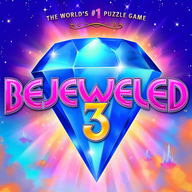

<h1 align=center>bejeweled3-nx installer</h1>

The installer page of [bejeweled3-nx](https://github.com/ChanseyIsTheBest/bejeweled3-nx), the native Nintendo Switch
port of Bejeweled 3 (Xbox Live Arcade): **https://chanseyisthebest.github.io/bejeweled3-nx-installer/**

You give it your own copy of the game, and it gives you a zip ready to extract into `sdmc:/switch/`. Everything runs in
your browser: the game files never leave your computer.

## What it does

1. **Finds your game** in what you chose (files or a whole folder): its content package
   `B6CB3450D57A979840BC9E33BE0BB1CA9FC3AE1958` (title `584111D6`, content type `0x000D0000`, read in place:
   `lib/from_sa2/stfs_package.js`), or a folder it was extracted into (`default.xex` with `main.rsb`). Bejeweled 3 has
   no title update and no add-on.
2. **Checks it** against `release/manifest.json`: `default.xex` by its SHA-256, the game's other files by their sizes.
3. **Downloads the build's NRO** and checks its SHA-256.
4. **Makes the renderer's shaders** (`deko3d_glsl.bin`): the 71 shader containers `default.xex` stores
   (`lib/containers.js`), translated by Renut's XenosRecomp (`wasm/renut_hlsl`), DXC (`wasm/dxc_web`) and SPIRV-Cross
   (`wasm/spirv_cross`) and turned into the GLSL the console's shader compiler takes (`lib/deko3d_glsl.js`,
   `lib/deko3d_package.js`). The package must match the manifest's SHA-256: it is the one the release was tested with.
   The game's other 18 shaders are not stored in any of its files (it compiles them while it runs with the Xbox's
   effect compiler, which a browser cannot run), so the NRO carries them.
5. **Writes the game pack** (`game_root.nxpack` + `.nxidx`, `lib/nxpack.js`) from the game's files.
6. **Streams the zip to disk** through the service worker, so nothing large has to fit in memory.

The zip holds `bejeweled3-nx/bejeweled3.nro` with its `LICENSES.txt`, `deko3d_glsl.bin` and `game_root.nxpack` +
`.nxidx`. The update zip holds the NRO, its licenses and the shaders. Neither holds `bejeweled3.toml`: the game writes
it at its first start, so an update never overwrites your settings.

## Checks

- `test/bj3_deko3d_node.mjs`: the 71 stored shaders come out of the page's chain as the native chain's GLSL (7 byte for
  byte, 64 with the same code and other SPIR-V temporary numbers: DXC v2025.1 against 1.8.2407).
- `test/bj3_manifest_node.mjs`: writes the build's entry of `release/manifest.json` from the tested files.
- `test/package_node.mjs`: the whole zip in Node with the page's code.
- `test/browser_package.html`: the same in the browser.
- `test/texts_node.mjs`: the interface texts.

## Layout

| Path | Contents |
|---|---|
| `index.html`, `app.js` | The page and its interface (`lib/i18n.js`) |
| `worker.js` | Builds the package off the main thread |
| `sw.js` | Offline cache and the download stream |
| `lib/` | STFS package reader, XEX reader, shader containers, deko3d shader chain, asset pack and zip writers |
| `wasm/` | WebAssembly builds: DXC and the LZX decoder (futari-nx-installer's), Renut's shader translator and SPIRV-Cross (`wasm/src/deko3d/build_wasm_deko3d.sh`, built from peggle2-nx, whose translator is bejeweled3-nx's) |
| `release/` | The list of builds and the licenses of the NRO; the deployment adds the NRO from the bejeweled3-nx release |
| `test/` | Node scripts and a browser page that run the same code as the page |

## License

GPL-3.0 (see [LICENSE](LICENSE)). Third-party components are listed in [NOTICES.md](NOTICES.md). The page is built on
[peggle1-nx-installer](https://github.com/ChanseyIsTheBest/peggle1-nx-installer) and
[peggle2-nx-installer](https://github.com/ChanseyIsTheBest/peggle2-nx-installer), themselves built on
[futari-nx-installer](https://github.com/ChanseyIsTheBest/futari-nx-installer),
[sa2-nx-installer](https://github.com/ChanseyIsTheBest/sa2-nx-installer) and
[nfsmw-nx-installer](https://github.com/StevensND/nfsmw-nx-installer) by StevensND.

Bejeweled is a trademark of PopCap Games / Electronic Arts; the icon artwork is © PopCap Games. This project is not
affiliated with or endorsed by PopCap Games, Electronic Arts, Nintendo or Microsoft.
